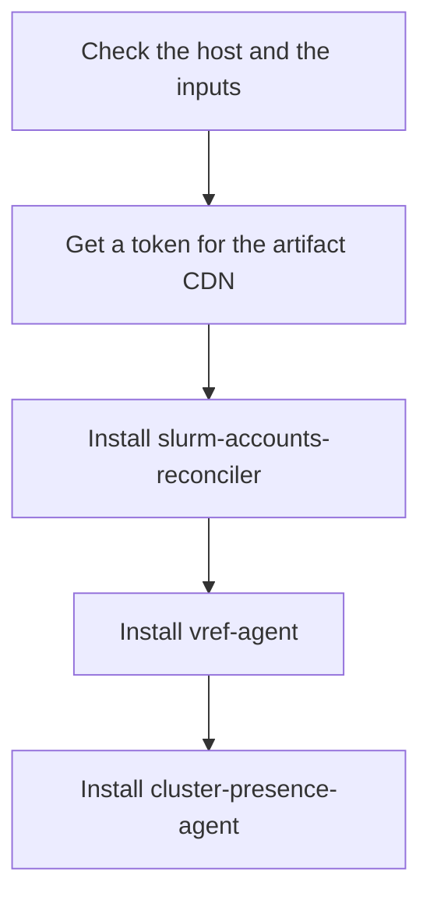

## The order of work

The first two steps always run, whatever tags you pass. The presence agent is last, so Vantage
shows the cluster as Connected only once everything else is installed.

## Checking the host and the inputs

Before changing anything, the role checks that:

1. The host is Ubuntu 26.04 on x86_64.
2. Every required variable has a value.
3. The Slurm user exists.
4. `/etc/slurm/jwt_hs256.key` and `/usr/bin/scontrol` exist, which is how it knows the node
   already runs Slurm.

A failed check stops the run with a message that names what is missing.

## How each binary is installed

The same steps install all three binaries.

1. **Sign in.** The role trades the cluster's client ID and secret for a short-lived Keycloak
   token.
2. **Fetch the checksum.** It downloads `<binary>.sha256` from the artifact CDN with that token.
   The URL is `<artifacts_url>/binaries/<binary>/linux-amd64/<version>/<binary>`.
3. **Download and verify.** It downloads the binary to `/var/cache/vantage-agents` and checks it
   against the checksum.
4. **Decide.** It compares the checksum with the binary in `/usr/bin`. When they match, the
   install steps are skipped.
5. **Install.** Otherwise it runs the downloaded binary's own `systemd-setup` command, which
   creates the service user, the directories and the unit files, and copies the binary to
   `/usr/bin`.
6. **Record.** It writes one line (name, requested version, sha256) to
   `/etc/vantage/artifacts.lock`. This is the same file and format that `v8x` writes.
7. **Configure.** It writes the settings file, owned by root with mode `0600`.
8. **Start.** It enables and starts the service or timer.

Because step 4 compares checksums, a second run changes nothing, and `latest` reinstalls only when
the CDN serves a new build.

## slurm-accounts-reconciler

Besides the common steps, the role:

- Copies the Slurm JWT signing key to `/etc/vantage/slurm-accounts-reconciler/jwt_hs256.key`,
  readable by root and the `slurm-accounts-reconciler` group (`0640`). The reconciler signs its
  own Slurm tokens with it.
- Adds a systemd drop-in, `10-vantage-agents.conf`, that starts the reconciler after `slurmctld`,
  `slurmdbd` and `slurmrestd`.
- On the Vantage image, runs the image's helper
  `/opt/vantage/bin/slurm-accounts-reconciler-identity` before each start. The helper makes the
  Slurm user an accounting operator. The start timeout is raised to 180 seconds, because the
  helper waits for `slurmdbd` on a first boot.
- Turns off the image's `slurm-accounts-reconciler.path` unit when it exists, so the enabled
  service alone starts the reconciler.

## vref-agent

vref-agent runs one pass and exits. A timer starts it every 10 seconds, and a path unit starts it
when the slurmctld hook reports a job event.

Besides the common steps, the role:

- Checks that the downloaded build has a `systemd-setup` command. Releases from 0.1.5 do. The
  older 0.1.3 build is the cloud-side agent and has none, so the role stops there with a message
  saying which version to set.
- Runs `systemd-setup --slurm-user <slurm user>`, so the hook directory is writable by the group
  of the user slurmctld runs as.
- Creates a system user named `vrefagent`. This is the Slurm identity the agent reads jobs as.
- Installs `/usr/local/sbin/vref-agent-slurm-token`, which mints a Slurm token for `vrefagent`
  with `scontrol token` and replaces `/etc/vantage/vref-agent/slurm.token` in one step, so the
  agent never reads a half-written file.
- Mints the first token, then enables `vref-agent-slurm-token.timer` to mint a new one on the
  schedule in `vantage_agents_slurm_token_refresh`. The agent reads the token file on every call
  and never mints a token itself.

### The slurmctld hook

`systemd-setup` installs a hook script at `/usr/libexec/vref-agent/vref-agent-wake`. The role does
not wire it into Slurm, because that means editing `slurm.conf`, which belongs to whoever owns
your Slurm configuration. Without the hook, the agent still reports every job, at most 10 seconds
late.

To wire it, set `PrologSlurmctld` and `EpilogSlurmctld` to that path in `slurm.conf` and run
`scontrol reconfigure`.

## cluster-presence-agent

The presence agent is a timer. Each run signs in with the cluster's credentials and reports to the
Vantage API at `vantage_agents_api_base_url`. The role writes its settings and enables
`cluster-presence-agent.timer`.

## Files on the node

| Path | Mode | What it is |
|---|---|---|
| `/usr/bin/slurm-accounts-reconciler`, `/usr/bin/vref-agent`, `/usr/bin/cluster-presence-agent` | | The binaries |
| `/var/cache/vantage-agents/` | `0750` | The downloaded binaries |
| `/etc/vantage/artifacts.lock` | | One line per installed binary |
| `/etc/vantage/slurm-accounts-reconciler/env` | `0600` | Reconciler settings, including the LDAP bind password |
| `/etc/vantage/slurm-accounts-reconciler/jwt_hs256.key` | `0640` | The reconciler's copy of the Slurm JWT signing key |
| `/etc/systemd/system/slurm-accounts-reconciler.service.d/10-vantage-agents.conf` | `0644` | The start-order drop-in |
| `/etc/vantage/vref-agent/env` | `0600` | vref-agent settings, including the client secret |
| `/etc/vantage/vref-agent/slurm.token` | `0640` | The Slurm token vref-agent reads with |
| `/usr/local/sbin/vref-agent-slurm-token` | `0750` | The token refresh script |
| `/etc/systemd/system/vref-agent-slurm-token.service` and `.timer` | `0644` | The token refresh units |
| `/etc/vantage/cluster-presence-agent/env` | `0600` | Presence agent settings, including the client secret |
